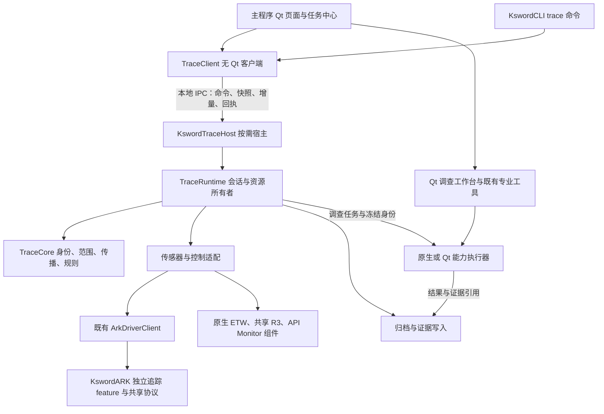

# KSword 单点追踪共享采集架构与 CLI 设计

日期：2026-11-23；方向更新：2026-11-24。状态：历史架构备选，已由用户选择的“三端各自组织实现”取代；尚未实现新核心、宿主、IPC 或命令。

## 当前决定：三端各自组织实现

2026-11-24，用户在讨论独立宿主与按需 DLL 后明确选择“还是各自写各自的”。Qt 主程序、Win32 主程序和 CLI 分别组织本端的追踪业务、会话、调查任务与交互；停止推进本文提出的统一 TraceHost、公共追踪 DLL、跨端 IPC 和统一 runtime 方案。下文保留为历史评估，不再作为当前施工架构或前置任务。

- 各端可以按需复用已经存在、可独立调用的底层函数，不为本轮规划先做全项目抽取或新建公共框架。
- CLI 采集与分析不得依赖创建 Qt 页面、Dock、隐藏窗口或控件；Qt 主程序内部自动调查同样直接调用后台能力，只有用户明确打开专业工具时才创建对应界面。
- 三端独立实现不改变仓库既有边界：R0/R3 协议仍唯一放在 `shared/driver/`，驱动 handler 仍经 registry 注册，用户态设备访问仍走既有 `ArkDriverClient/`；不复制三套协议或驱动。
- 各端可以维护独立会话，但既有全局传感器、目标 Agent 租约和调试占用仍须检查；独立实现不代表允许同时抢占或互相 STOP。
- 后续可执行计划按“前端 → 业务模块 → 具体产物 → 前置验证 → 验收条件”拆分，明确各端覆盖，不再把跨端同一真实会话作为默认承诺。CLI 与内置 help 同步要求继续适用。

本文的 `trace` 命令仍全部是历史接口草案，不因方向调整成为现有能力。公告能力的共同目标继续以需求规划为准；本次调整没有开始代码实现。

需求唯一来源为 [恶意行为单点追踪与调试能力规划](恶意行为单点追踪与调试能力规划.md)。本文负责工程分层、共用范围、CLI 形式与迁移顺序，不另行扩大检测范围或宣称执行传感器已经解决。

## 1. 历史方案的结论与工程取舍

**推荐“无 Qt 共享追踪核心 + 按需独立采集宿主 + GUI/CLI 共用客户端 + 主程序调查工作台与能力执行器”，既有后端按功能渐进抽取。** 不建议分别维护两套采样系统，也不建议把整个主程序后端完全解绑作为本能力的开工前提。

用户进一步明确：行为树需支持全局下断后一键解析线程堆栈、内存及 shellcode dump，并联动 KSword 全方位检索。无 Qt 边界约束追踪核心和客户端，不要求现有所有分析算法、任务执行器或专业界面去掉 Qt；主程序保留完整交互分析能力。

需要同时解决两种共用：

- **代码共用**：事件解码、采集状态机、关联、规则、取证与归档只保留一份实现。
- **运行会话共用**：同一真实采集会话只由一个所有者持有驱动句柄、ETW consumer、Agent 租约和停点，GUI/CLI 通过订阅及控制连接它。

仅将代码放进 shared 或静态库，可以解决第一项；两个程序各自实例化同一库仍然是两套运行会话，不能因此宣称已消除重复采集、配置冲突和双重恢复。

独立宿主初期只负责本能力，不把全项目所有查询和监控搬进去。它按显式启动请求创建，首版不安装 Windows 服务；是否需要无人登录运行、跨登录会话或开机持续采集，再决定服务化。共享核心不依赖宿主形式，未来可以换承载方式。

## 2. 当前源码说明了什么

以下是本轮只读核对的代表入口，并非对全项目后端完成全面审计。

| 当前实现 | 已有基础 | 对本架构的含义 |
| --- | --- | --- |
| `shared/usermode/backend/` | C++20、无 Qt，Light/CLI 使用，覆盖枚举、控制、性能与 ETW 等模块 | 可以直接复用；已有迁移不能推导为主程序也已切到同一实现 |
| `KswordCLI/KswordCLI.vcxproj` | 直接编译主程序目录内的多个 `ArkDriverClient/*.cpp`，并编译共享 R3 源码 | 目录位于主程序下不等于依赖 Qt；不必先搬目录或重写一份驱动客户端 |
| `shared/ApiMonitorCapture.*` | Qt-free 的限时控制器，复用注入器、租约、broker、包解码与覆盖接收器 | 有很好的非 GUI 先例，但 GUI 当前未直接使用该 Capture 控制器，整个会话编排尚未统一 |
| `KswordCLI/R3MonitorApi.cpp` | `monitor api capture`、结构化回执与取消 | 新命令可沿用参数、help 和结果规范；现有命令是限时采集后输出 |
| `shared/usermode/backend/monitor/EtwSessionController.*` | 原生工作线程、callback、启停、清理回执和 ETW 丢失统计 | 可复用资源管理经验；摘要行和通用 provider 控制不能冒充完整 syscall 或写入传感器 |
| `MonitorDock/DirectKernelCallMonitorWidget.*` | QWidget 同时持有采集线程、ETW 句柄、缓存及 QString 展示字段 | 需要抽取 syscall 会话与原始证据，Qt 留在投影层 |
| `MonitorDock/ProcessTraceMonitorWidget.Capture.cpp`、`ProcessTraceEventArchive.h` | 已有进程定向采集、归档及详情投影；归档值仍含 QString、FieldDocument 和语言快照 | 可迁移语义与生命周期，不能直接当作新核心的无 Qt 事件结构 |
| `MonitorDock/KernelCallbackMonitorWidget.cpp` | 页面创建 worker、读驱动 ring，并调用全局 START/STOP | 驱动访问已封装，但会话所有权仍与页面绑定 |
| `shared/evidence/` | 身份、关系图、证据覆盖及 syscall 判据 | 优先复用既有身份与证据模型，扩展缺少的运行时语义 |
| `Framework/BackgroundTaskRegistry.h` | Qt 侧常驻任务登记与控制视图 | 保留为 GUI 适配，不作为无 Qt 采集核心的调度器 |
| `ProcessDock/ThreadStackWindow.cpp`、`KswordCLI/R3ThreadStack.cpp` | GUI 与 CLI 各有用户栈捕获/展开流程；GUI 耦合 Qt 结果和 worker | 不是同一套完整共享执行器，需逐步统一快照/展开语义，不能只复用窗口按钮 |
| `ArkDriverClient/ArkThreadStackCapture.h` 与对应实现 | 已有 GUI/CLI 共用的持句柄内核栈采集及来源校验 | 可优先接入调查任务；不保证适用于所有停止后线程，APC 来源尤其需核对可运行条件 |
| `MemoryDock/MemoryDock.RegionDump.cpp` | 已有身份与区段核验、R3/R0 读取、QSaveFile 发布及取消 | 可先由 Qt 适配器接入，再抽取读写任务；不能视为已具备所有格式的进程转储能力 |
| `ProcessDock/KernelDumpStackClient.*` | 主程序已通过同目录 CLI 执行离线内核转储栈展开，隔离 DbgHelp | 已有主程序调用独立分析执行端的先例，Qt 与原生执行可以双向组合 |

关键事实：Callback Monitor v1 的 `afterSequence` 支持独立读游标，但类别掩码和 STOP 为全局控制。`callback_monitor.c` 的 START 会设置共享掩码，STOP 清零；现有页面退出或失败清理会调用 STOP。**多读者能力并不等于多租户启停安全。** API Monitor 则已用跨进程 SessionLease 防止同一目标出现多个控制者，应延续而非绕过。

## 3. 备选路线比较

| 路线 | 优点 | 成本与限制 | 建议 |
| --- | --- | --- | --- |
| GUI/CLI 各写采集系统 | 各自开发直观 | 解码、归因、清理及覆盖容易分叉，双控制者争用 | 不采用 |
| CLI 引用 QWidget，隐藏主界面 | 初期复制少 | CLI 被迫依赖 Qt Widgets、页面构造及 UI 生命周期，后台运行仍难以管理 | 不采用 |
| 抽成 QtCore/QObject 后端供两端链接 | signals/slots 和已有工具可保留 | 技术上可行，但给无 Qt CLI 增加 Qt 部署与事件循环依赖，也不能单独解决会话唯一所有者 | 局部过渡可用，不作为新核心基线 |
| 先整体解绑全部主程序后端 | 长期边界统一 | 改动面和回归成本过大，很多 UI 辅助无需迁移，延迟关键传感器验证 | 不作为前置工程 |
| 无 Qt 核心，两端各自承载 | 复用代码，适合受控原型和单前端工具 | 终端退出与主程序关闭影响会话；同时连接仍需额外协调 | 原型可用，正式共享会话不止于此 |
| 无 Qt 核心，按需独立宿主 | 共用代码与真实会话，GUI/CLI 可同时观察，生命周期可预测 | 增加小型 IPC、宿主部署及授权管理 | 推荐正式形态 |
| 从第一天安装系统服务 | 能支持无人登录运行 | 安装、升级、Session 0、权限和恢复面扩大，当前需求不必全部承担 | 后续有明确需求再评估 |

将 Qt 字符串换成 STL 字符串只是边界调整的一部分。真正需要抽出的还有资源所有权、回调的线程与寿命、原始状态、取消及失败恢复；不能把依赖 `Framework.h`、`kPro.UI()` 或窗口指针的对象换个目录便称解绑完成。

## 4. 推荐依赖方向与部署形态



图中各块是职责边界，不要求每块新建 DLL 或项目。首个可运行原型先由测试宿主直接链接同一 runtime；通过后再接 IPC。正式 GUI/CLI 新追踪入口统一访问宿主，避免同时开放语义不同的“本地采集”和“远端采集”两套产品路径。

### 4.1 建议目录及工程粒度

以下路径均为拟定目录，当前不创建占位工程或空接口：

| 拟定落点 | 职责与允许依赖 |
| --- | --- |
| `shared/trace/model/` | 值类型、能力描述、命令及回执；STL 与适用 evidence 类型，不依赖 Win32/Qt/UI |
| `shared/trace/core/` | 进程集合、区域代次、传播关系、规则判定；只消费结构化事实 |
| `shared/trace/runtime/` | 会话生命周期、队列、动作编排和多订阅者；不引用 UI |
| `shared/trace/windows/` | Win32 传感器、身份句柄、ETW/驱动/Agent 及取证适配，使用原有共享库 |
| `shared/trace/archive/` | 原始与规范化记录、manifest、提交水位及证据文件索引 |
| `shared/trace/ipc/` | 宿主与客户端的消息版本、编解码及本地传输；不复用驱动 ABI 充当 IPC |
| `shared/trace/client/` | 两端共用的连接、订阅、命令与重连；不含 QWidget 或命令行解析 |
| `KswordTraceHost/` | 小型控制台宿主，持有 runtime；不承载业务判据或 GUI 格式化 |
| `KswordCLI/TraceCommands.*` | 命令参数、输出、取消和内置 help 接入 |
| 主程序 `MonitorDock` 下的追踪适配 | 参数草稿、展示投影、任务登记及异步客户端连接 |
| 主程序中的调查任务适配模块 | 调用既有 Qt 分析能力、加载冻结证据并路由专业工具，不把窗口类加入共享核心 |
| `shared/driver/KswordArkTraceIoctl.h` | 后续确需新增时，唯一 R0/R3 ABI 定义，名字与 IOCTL 编号届时核定 |
| `KswordARKDriver/src/features/trace/` | 独立追踪 handler 与实际逻辑，经 registry 注册 |

建议核心及 Windows runtime 以静态库组织，新宿主链接 runtime，GUI/CLI 链接同一 client。原型阶段也可用一个共享 MSBuild 源清单接入，避免为拆库先重构整套解决方案；一旦形成正式库工程，消费方不得又手工编译相同源码。暂不引入公共 C++ DLL ABI、插件框架或第二套打包系统。

跨多个静态库使用时保持相同工具集、CRT 与配置，按仓库固定 IntDir/OutDir 构建。源码文件基名和对象输出必须避免碰撞；新源码同步各工程及 filters。宿主正式产物放统一 `Ksword5.1/x64/Release/`，发行时与 CLI、主程序及协议版本配套。

`ArkDriverClient/` 当前虽在主程序目录，已有 CLI 共编先例，短期保持位置及 API。新 runtime 经它访问设备；以后是否迁到 shared 作为独立项目决策，不能在设计阶段另造一个 TraceDriverClient 重复 DeviceIoControl 与校验链。

### 4.2 Qt 的保留边界

Qt 保留页面、模型、图表、主题、多语言、StructuredFieldView/CodeEditorWidget、应用设置草稿和任务中心，也可保留当前依赖 Qt 的分析执行模块。GUI 用 QObject 适配器将后台值批量投递到 UI 线程，使用代次拒绝迟到数据。

核心接收明确的配置值、取消请求和结构化结果；不能包含 QString、QTimer、QWidget、QPointer、UI 日志类型或同步询问弹窗。技术诊断由可注入 sink 输出，GUI 再转换到 kLogEvent 日志，CLI 转换到 diagnostics/stderr；业务关联 ID 在整个调用链保留，不在每层重造。

可供脚本和 UI 使用的错误码、来源、范围、时钟与完成状态来自共享模型。本地化文本、表格列、搜索拼接和卡片文档为投影，不能充当核心的事实源或成功判据。

“无 Qt 核心”不限制所有执行器的内部技术：可以存在依赖 QtCore 的无窗口 worker，也可以在运行中的主程序里保留暂未解绑的分析模块。统一任务和证据协议，按需选择执行器；不能把“用了 Qt”直接等同于“只能通过点击窗口调用”。确实依赖 QWidget 或交互草稿的部分明确标记为需要 GUI，不能在后台偷偷构造页面执行。

### 4.3 既有整个采样系统如何共用

共用策略按工作性质选择，不强制所有主程序后端经过 TraceHost：

| 工作性质 | 推荐运行方式 | 共用内容与边界 |
| --- | --- | --- |
| 单次清单、字段查询、只读快照 | GUI/CLI 各自调用同一共享函数 | 共用业务实现和返回模型；两次请求可以是两个采样时刻，无需为了去重启动宿主 |
| CPU、内存、磁盘等周期指标 | 共用 sampler 实现；需要同一历史或同时观察时再共用采样所有者 | 采样间隔、计数基线、历史身份属于 sampler；不从 Qt 表格反读数据，也不把界面刷新频率当成真实采样率 |
| ETW、回调、Agent 等事件来源 | 有生命周期或全局冲突的来源由明确所有者承载 | 同源且配置兼容时共用一次采集，多客户端独立过滤；不兼容时隔离或拒绝 |
| 本能力的进程范围、传播链、规则和证据 | 正式入口统一由 TraceHost 承载 | GUI/CLI 必须看到同一权威会话和动作结果 |
| dump、符号、慢查询等辅助任务 | 既有原生或 Qt 实现，经统一任务编排按需调用 | 保留 jobId、原始身份和取消，执行端依赖如实声明；没有必要变为持续采样 |
| 图表、表格筛选、语言、主题、窗口状态 | 留在各自前端 | 展示所需的重采样/聚合可共享纯算法，控件和可见性仍不进入核心 |

对周期指标，只有目标身份、计数语义、基线和精度要求兼容才合并；如果以后采用共同采样宿主，由它确定真实采样节奏，客户端可以降采样，不能从低频源补造高频历史。增加消费者也不应悄悄改动原任务的间隔与历史口径。

由此可分开估计迁移工作量：已有无 Qt 的共享查询通常只需接入；页面内会话/worker 抽取属于中等改造；全局驱动控制仲裁、调试所有权和同步执行传感器属于较高风险。最后一类不能通过先整体移除 Qt 降低其技术难度。

## 5. 采集、进程范围与同步控制的分工

### 5.1 事件路径

```text
传感器原始事实与来源序号
  → 有界接收与校验，保留原始证据
  → 进程/线程实例与操作配对
  → 进程范围、区域版本及覆盖账本
  → 传播关系与规则判定
  → 有权限的控制/取证队列
  → 规范化归档与客户端增量
```

共享代码不等于新增了写入传感器。普通 syscall ETW、Callback Monitor、R3 API Hook 各自保留原覆盖界限；不能用通用事件摘要猜测实际写入地址、长度、执行线程或调用成功。

每种传感器实现 Start、查询真实能力、更新范围、Stop 与清理回执，包含来源身份、代次、已生效配置和覆盖起止。仅在需求存在第二实现时再提炼公共接口，不提前为所有 Windows 采样器设计统一大接口。

### 5.2 防止 A → B → C 在纳入时断链

进程纳入必须有“请求时间”和“实际生效边界”，不能只在 UI 树上增加 B 就认为已经覆盖 B。

对于支持同步纳入的来源，R0 在可支持的操作边界内维护有限目标集合，先使 B 成为受跟随对象再按协议放行相关路径。详细来源图和字符串留在 R3；内核只维护必要身份、集合代次及可执行的有限策略。此方式仍需验证失败操作、并发和共享映射，不代表自动获得执行监听。

只有异步事件时，先启动实际所需来源，再绑定种子；可在有限预算内保存超出当前集合的最小关系事件，以支持乱序和晚纳入补关联。采集最小元数据范围、保留时长和成本必须可见；这仍以种子在线跟随为目的，不将功能改造成全机事后复原。保留窗口已过、目标身份未知或丢包时，标记缺口。

若所选来源既不能同步扩大集合，也不能保留下一跳事件，则该组合不能标为“连续传播覆盖”。以进程为颗粒度也不能免除这项验收。

### 5.3 快路径与普通规则

需要在目标执行前生效的条件，必须预先下发给实际支持同步控制的后端；R0 不等待宿主通过 IPC 再询问 GUI。后端只接受已经验证的有限条件及动作，不执行任意用户脚本。普通 R3 规则适合关联、通知、异步 dump 和后续暂停，明确这些动作发生在事件送达之后。

能力描述分别列出可观察操作、同步边界控制、执行进入停点与实际执行确认。`pause` 指令返回 accepted 也不表示对象已停止；必须有权威状态和 stopId。线程挂起、原生调试停点、采集暂停与显示冻结使用不同动作。

## 6. 一个真实会话，多个观察客户端

### 6.1 所有者与资源仲裁

宿主持有传感器和动作资源；会话有稳定 sessionId、宿主实例代次、配置修订及创建主体。每个 GUI/CLI 连接有自己的订阅游标，断开订阅不重启传感器。每个会话同一时刻只有一个控制租约，其余连接只观察；控制权交接需要显式授权和新代次，旧控制请求失效。

同一受支持授权域内使用一个按需宿主协调多个逻辑会话，按真实资源键仲裁：ETW 会话/配置、驱动追踪会话、目标进程实例的 Agent 租约及调试控制权。能共享的源合并一次采集；不兼容配置或执行控制冲突返回明确失败，不静默替换。

API Monitor 保留既有全局目标租约；如已由旧 GUI 的独立 Agent 会话占用，先报告冲突，不能强制接管。Callback Monitor v1 初期仅可复用被证明已满足条件的只读来源，或在所有启停入口纳入同一仲裁后使用。没有这种前提时，不允许宿主与旧页各自 START/STOP；仅查询掩码、加一个宿主 mutex 均不能约束未迁移的旧页面或旧进程。后续若需真正多租户，设计版本化驱动订阅/引用生命周期，不能伪称 v1 已支持。

### 6.2 生命周期及失败恢复

建议会话阶段为 Preparing → Arming → Running → Stopping → Stopped；Faulted、CleanupPending 及覆盖降级单独可见。目标暂停状态独立维护，不把 Paused 混入“采集是否还运行”的唯一布尔值。

- 创建先校验配置、身份、权限、能力与输出位置，再获取资源并设防。只有收到真实就绪回执才进入 Running。
- 停止关闭新动作入口，撤销本会话设防/控制责任，按来源排空可确定的尾部记录并提交归档。各步骤独立记录，失败保留原资源身份供重试。
- 普通观察者离开不改变采集。关闭 GUI 页默认解除本页订阅；显式停止才停止会话，主程序退出根据会话的前台/后台策略显示真实后果。
- 前台 `run` 的控制终端离开时请求停止并等待回执；后台 `start` 会话可在无客户端时继续，直到显式停止、时限或预设故障策略触发。
- 控制客户端断连不直接释放目标停点。宿主按预先选择的控制租约失效策略处理，首版默认停止会话并归还自有暂停责任，随后记录回执。
- 宿主自身死亡必须由下层文件 Cleanup、既有 Agent 租约机制及支持范围内的独立恢复责任处理；不能宣称连接断开就已恢复。未验证崩溃恢复的后端禁止启用无人值守自动暂停。

重新连接使用宿主代次和 sessionId；宿主重启后，旧会话只能按归档标记中断。重新开始创建新会话与覆盖起点，不能接上相同 ID 假装中间没有缺口。

### 6.3 IPC 与一致性

建议本地命名管道：控制请求/回执与事件订阅分开，避免大批事件挡住停止请求。协议显式包含版本、消息类型、长度和请求 ID，采用确定的编码，不跨进程直接发送 STL/C++ 对象布局。首版可用 UTF-8 JSON 帧与已有可复用 lossless 解析能力，原始大块和 dump 走归档引用；实际吞吐后再决定是否引入二进制事件批次。

端点限定本机和预期主体，核对真实连接进程、登录会话及令牌权限。高权限宿主不因 SID 相同就接受低权限客户端任意控制；观察和变更授权分别检查。连接握手返回版本、hostEpoch 和能力，不把 nonce 当作全部授权依据。初期不提供网络远程管理。

变更请求携带 requestId、期望会话/控制代次及适用的配置修订。停点动作额外绑定 stopId、进程/线程实例。重试查询原请求回执，不能因超时重发 dump 或继续而重复执行；宿主重启后返回结果未知，不承诺跨崩溃恰好执行一次。

快照包含 revision 与事件水位，增量从该水位之后继续。客户端落后超过保留范围时收到显式 gap 和新快照入口；取消流只关闭此订阅。显示过滤不改变采集/关联所需事件，采集过滤的变更则产生新配置与覆盖边界。

### 6.4 停点调查工作台与 Qt 能力执行器

这一层负责“从树上一次发起调查，并使用 KSword 全部适用能力”。它是主程序的重要业务层，包含调查预设、任务组合、结果导航和人工深挖，不只是共享事件的显示投影。

#### 停止组与调查批次

全局下断作用于本追踪会话请求时冻结的对象集合，形成停止组。建议停止组记录 groupStopId、目标实例、各对象 stopId/控制机制、确认状态及生效时间；新发现对象单独标记，不能静默算入旧组。部分停止成功仍可对成功对象调查，失败对象展示明确回执。

一键调查从已有停止组或选中节点创建 investigationId，冻结 graphRevision、对象集合、区域版本、调查预设版本和证据批次。执行中的树选择变化不改变正在调查的对象；同一进程出现在多个分支时去重执行，用关系引用连接结果。

#### 推荐的执行顺序

1. 回读停止状态与原控制所有者，确认调查范围，冻结可用的权威线程上下文。
2. 优先保存寄存器、原始栈字节、关键代码区、模块/映射及展开所需元数据；记录未捕获范围。
3. 按预设执行区域/模块/进程转储和适用的相关对象查询，逐项给出完整、部分、失败或不支持。
4. 尽量基于保存证据展开与符号化调用栈、分析载荷、检索字符串和交叉关系；额外实时读取标为新的来源，不伪装成原停点快照。
5. 结果挂回行为树节点，允许打开已有线程详情、内存工作台、转储查看器、反汇编及其他适用工具。

采集阶段与解析阶段分开。符号下载、反编译和 UI 生成不需要长期保持控制锁；用户继续后，冻结证据仍可供解析。默认一键调查完成后保持用户原有停止，由原所有者明确继续。若用户在未完成采集时要求继续，先按动作资格取消或结束相应实时采集，返回已保留证据；不得在恢复后继续宣称读取来自旧停点。

暂停一组目标不能证明共享页、外部进程或内核不再写入，保存逐项采集时间及一致性等级。APC 采集可能依赖目标运行，停点状态下不能为了完成抓栈偷偷放行；优先使用可用的停点上下文或保存上下文来源，不能取得时如实返回边界。用户栈、内核栈和事件时调用栈来源独立，不拼接成一条没有证据的完整栈。

#### 执行器分工

| 执行位置 | 适用能力 | 当前工程策略 |
| --- | --- | --- |
| 宿主中的原生执行器或既有独立 helper | 已无 Qt 的身份/模块/内核栈、适用的内存读取与离线解析 | 直接复用，GUI/CLI 同一能力契约 |
| 主程序中的 Qt 能力执行器 | 当前混合 Qt 状态、结果类型或任务控制的用户栈、区域 dump 及其他调查能力 | 先以明确参数/结果接口接入，可保留 Qt；工作线程执行耗时业务，GUI 线程只负责适用的界面操作 |
| 可选 Qt 无窗口分析 helper | 已能脱离 QWidget、但依赖 QtCore 或 Qt 分析模块的任务 | 在确有 CLI 无界面需求时抽取，不从第一天复制一套完整主程序运行时 |
| Qt 专业工具导航 | HEX/反汇编、内存工作台、转储浏览及字段详情 | 加载证据或明确的实时目标，保留原工具结构及控制语义 |

执行器表是有限能力的内置适配，首期不做通用远程插件框架。每项声明是否需要 GUI、是否可无界面执行、是否需要持续停点、输入是冻结证据还是实时目标、结果格式及支持架构。宿主选择一个兼容执行端，同一 job 不由 GUI 与 CLI 各跑一遍。

主程序可以登记自身可提供的能力与端点代次；退出时不再受理任务，在途任务取消/完成结果分别回报。未安装 Qt helper 且主程序不在线时，仅有 GUI 才支持的项目返回 executor-unavailable，不自动启动窗口或重写成另一种语义；批量调查中的其余可用项目继续，汇总为部分结果。CLI 二进制本身仍无需链接 Qt，Qt 运行依赖属于明确选择的执行端。

宿主仍是动作、停止组与归档的权威所有者。Qt 执行器收到带身份、范围、停点代次和预算的任务，实时读取需通过原所有者核验的读取通道，或经协调取得有限读权限；不能另开调试会话，也不能调用页面现有停止/继续入口接管目标。旧函数内的自有挂起计数与恢复逻辑须经适配审查，不能原样套在任意停点机制上。

主程序内存编辑器的修改保持原有暂存/显式写回语义，调查默认只读；打开工具成功不等于取证任务已完成。已有 x64dbg 导航桥仅提供适用的导航能力，不能用于抢占已有调试事件或自动二次 attach。

#### shellcode 与进程转储的结果契约

shellcode dump 首先是“有来源依据的候选代码字节提取”：输入可来自写入区间、实际进入位置、已标记版本或用户范围，输出原始文件及 VA、位数、入口、区间/边界依据、读取掩码、版本与 hash。边界未知时保留候选与预算，不将一页或整段分配自动命名为完整 shellcode，也不以重新构造 PE 为导出的必需条件。反汇编/反编译是进一步分析，不是 dump 成功的证明。

进程转储、模块原始内存与区域文件使用不同类型和能力项，说明格式、覆盖范围、缺页和恢复上下文。现有区域 dump 不意味着已有任意格式完整进程转储；缺少某种输出时按独立能力补齐，不用 raw 文件伪装标准 minidump。

#### 树与既有工具的连接

从会话/分支发起批量调查，从进程/线程/区域发起定向调查；进程节点展示采集任务，线程节点关联上下文与栈，区域节点关联字节证据和分析，文件/网络结果保留原来源。结果引用 investigationId、entityKey、evidenceId、stopId 或各自采样来源，用户切换到历史批次时不自动刷新成当前进程状态。

专业工具优先消费冻结证据，允许用户显式切换实时读取。跳转必须携带稳定对象身份、VA/范围和模式，不能只给 PID/地址让目标工具重新猜测。此处只确定交互职责，未实现新 GUI 页或重新设计既有专业控件。

## 7. CLI 能力形式草案

**以下 `trace` 命令均为拟定接口，不是当前可用命令。** 本轮不修改命令注册或内置 help。落地时须同时更新注册元数据、[CLI 使用文档](CLI使用文档.md)、[监控命令文档](cli/monitor.md) 及适用覆盖清单。

### 7.1 按用户任务组织命令

| 拟定命令 | 作用与返回 |
| --- | --- |
| `trace capabilities` | 查询来源、部署条件、同步控制及执行监视能力；未运行宿主时不启动采集或加载驱动 |
| `trace plan validate --file PATH` | 离线校验计划结构、规则及预算，不注入、不加载驱动 |
| `trace run` | 前台创建并观察新会话，直到限时、停止或取消；可用于脚本和受控实验 |
| `trace start` | 明确创建后台会话，返回 sessionId、实际能力、就绪及输出位置 |
| `trace sessions` / `trace status --session ID` | 查询会话目录或单会话真实阶段、覆盖、控制占用及清理状态 |
| `trace events --session ID` | 有界查询或按游标订阅；显示流和原始归档语义分开 |
| `trace graph --session ID` | 查询进程关系、区域及线程证据，支持树形文本与机器可读图 |
| `trace acquire-control --session ID` / `trace release-control` | 在授权下获取/归还控制租约，不自动争抢已有控制者 |
| `trace pause` / `trace resume` | 按实体身份执行有能力支持的暂停/恢复，携带会话、实体及停点身份 |
| `trace capture --session ID --entity KEY` | 请求已有能力支持的 dump、区域或网络取证，返回 jobId 与状态 |
| `trace investigate --session ID --stop-group ID --profile NAME` | 对停止组按预设组织堆栈、内存、载荷及关联检索，返回 investigationId、子任务及结果证据；支持按范围裁剪 |
| `trace jobs --session ID` | 查询异步动作实际完成、部分失败及证据引用 |
| `trace stop --session ID` | 幂等停止，分别报告采集停止、控制恢复、尾部处理和归档提交 |
| `trace export --session ID` | 导出已采集证据和关系，声明范围、水位、筛选及缺口 |

pause/resume 的最终参数和后台控制租约的凭据存放方式在实现阶段核定；命令不能以裸 PID/TID 或一次 CLI 进程的生命期冒充会话控制身份。离线归档查询可另设 `--archive PATH`，与在线 session 明确互斥，不为导出启动采集。

### 7.2 典型使用形式

```powershell
# 草案：查询能力与离线计划，不启动采集。
KswordCLI.exe trace capabilities --json
KswordCLI.exe trace plan validate --file trace-plan.json --json

# 草案：对现有种子开展进程级前台追踪，绑定计划和固定证据目录。
KswordCLI.exe trace run --pid 4321 --plan trace-plan.json --duration-ms 60000 --out E:\Cases\case01 --confirm --json

# 草案：后台会话明确创建，稍后可由 GUI 或新的 CLI 连接观察。
KswordCLI.exe trace start --pid 4321 --plan trace-plan.json --out E:\Cases\case02 --confirm --json
KswordCLI.exe trace status --session SESSION_ID --json
KswordCLI.exe trace events --session SESSION_ID --follow --after CURSOR --jsonl
KswordCLI.exe trace graph --session SESSION_ID --json
KswordCLI.exe trace stop --session SESSION_ID --confirm --json
```

`--pid` 只是选择入口，宿主打开并冻结进程实例后才执行，回执给出创建身份与开始边界。用户提供预期创建身份时必须核对，不匹配拒绝；监控前历史明确未覆盖。启动样本模式以后可增加，但只有后端能证明监视已在目标开始执行前就绪时才声明“从启动跟随”，不能简单 CreateProcess 后补监视。

示例输出目录用于用户调查证据，与编译和运行测试产物分开；开发验收仍遵守固定输出位置要求。`--confirm` 延续现有 CLI 变更操作约定，读取/观察不要求它。后台会话默认返回观察权限；后续变更仍需有效控制授权。

### 7.3 计划内容与版本

计划建议先用有 schemaVersion 的 JSON，GUI/CLI 共同编辑和验证同一模型，保存时带 revision/hash。包括：

- 种子及身份要求、进程纳入策略、明确的退出与排除条件。
- 必需/可选传感器、是否要求同步能力、允许的覆盖降级；不满足必需能力则启动失败，不偷偷换源。
- 最大进程数、事件/内存/磁盘预算、运行时长和订阅保留范围。
- 有限条件规则、自动/半自动动作、取消和控制租约失效策略。
- 证据类型、目标位置、采集范围和保留配置。

初始默认仅进程级观察，执行监视、注入式来源及自动暂停按明确计划开启。规则若要求当前来源不支持的“执行前暂停”，校验失败。配置修改只影响明确生效边界之后的事件，保留旧规则版本；本次范围内不引入任意脚本执行引擎。

调查预设也使用同一版本化模型，描述范围、采集项目、解析项目、预算和停止保持策略。GUI 的“一键调查”与 CLI `trace investigate` 提交同一种请求；能力探测同时报告当前原生、Qt 无窗口和在线主程序执行端，不能因 CLI 使用相同命令便假定所有桌面分析组件在无 GUI 环境都可用。

### 7.4 输出、退出及流式结果

有限命令沿用现有 Result/envelope 与退出码惯例：0 表示本次请求成功，1 参数错误，3 操作失败，5 明确不支持，6 部分结果。状态查询返回 0 只表示查询成功，不能覆盖会话内部的 degraded/failed 状态；完整性字段必须在 data 中独立表达。

新命令是混合来源，需在中央输出层明确复合来源的合法表示，不能因沿用旧默认 `backend=r3` 便暗示未使用 R0。现有命令输出保持兼容；在新命令接入时制定版本化 envelope，列出请求能力与实际 sources。

`--json` 返回一份有限结果；`--jsonl` 用于新流式能力，与 `--json` 互斥。当前 CommandRegistry 的 Result 是一次性返回，流式接入需扩展明确的输出通道，不能让 run 回调先写事件、随后由 emit 再混入普通结果。stdout 只写机器记录，诊断进 stderr。

JSONL 至少区分 ready、event、graphDelta、gap、status 和 final；记录 schemaVersion、sessionId、hostEpoch、cursor、源序号和配置版本，未知值用 null，地址/句柄为十六进制字符串，64 位计数和时间为十进制字符串。最终记录说明停止原因、完整性和清理结果；异常断开无 final 时，消费方不能推断完整。

Ctrl+C 在 `run` 请求停止其创建的会话并等待清理，二次中断或硬退出可能只有部分结果；在 `events --follow` 只解除订阅，不停止他人的会话。慢 stdout 不阻塞采集与执行控制，超出订阅预算通知 gap；需要无该层缺口的消费方读取实际已提交归档。

## 8. 归档、顺序与损失账目

宿主维护唯一会话档案，GUI/CLI 的展示保留窗口可以不同。建议 manifest 保存版本、主机/系统/驱动/传感器身份、计划、起止、覆盖及清理回执；分段事件文件保存原始依据与规范化事件；证据目录保存 dump、区域与网络文件，索引引用来源实体和采集动作。具体文件布局在原型验证后冻结，不把 JSONL 示例直接视为高吞吐最终选型。

时间分别保留源时钟、QPC/频率、UTC 映射及接收时刻，源内序号与宿主接收序号分开；不能按跨核时间戳简单排序便证明因果。跨来源重复保留 evidenceRefs，只有可证同一操作时合并，不把相似事件计成两次传播。

独立记录传感器丢失、驱动 ring 覆盖、传输不完整、关联缺口、归档写入失败、客户端订阅丢失及显示窗口移出。层级计数可能相关，不能盲目相加为总漏报数。接受、写入与刷盘分别有水位；归档失败按预设策略标记降级或停止，不将“已排入写队列”显示为持久保存。

回调只做必要复制和有界提交，昂贵解析、符号、图投影和写盘下放工作线程。动作与停止不排在无限事件队列之后；内存/磁盘达到上限时显式响应。不得为避免丢包在持有任意内核锁的路径上阻塞等待磁盘或 GUI。

## 9. 迁移顺序与验收门槛

| 顺序 | 工作范围 | 通过依据 |
| --- | --- | --- |
| A：验证关键来源 | 自有进程夹具，先证明进程级连续传播和来源参数；执行监视单列 | 独立事实对照、准入生效时序、失败/部分写入及已知缺口；此时不先做完整 UI/IPC |
| B：无 Qt 核心与 runtime | 身份、范围、关系、覆盖和控制回执，通过原生宿主运行 | 不含 Qt/UI 的头依赖与链接检查；受控真实路径，不只回放模型 |
| C：按需宿主与客户端 | 一个宿主运行会话，CLI 可查询/停止，支持重连 | 真实双客户端、断连、重复请求、慢订阅、清理失败与崩溃恢复 |
| D：主程序接入 | 新页面只消费同一客户端与规范化数据 | GUI/CLI 同一 session 的快照/水位一致，关页/切 Tab/切主题不重建采集 |
| D1：停止组调查闭环 | 全局下断后一次发起栈、关键区域与候选载荷采集，Qt 适配器联动原有工具 | 真实停点身份、分支对象去重、按批次挂回树、调查后保持停止、单项失败不伪装整体成功 |
| E：旧采集逐项迁移 | 先选 Callback/进程定向 ETW/syscall/API 的一条具体链 | 切换后只有一个权威所有者，保留各来源完整语义，旧入口退为适配 |
| F：扩展控制与取证 | 多跳、线程/区域增强、规则动作及归档 | 各自真实支持矩阵与回归，不以进程级通过代替线程级保证 |

迁移既有采集器时先切开“原始值和状态”“资源与 worker”“Qt 投影”，逐项替换真实入口并保留回归基线。R3 backend 已有能力直接复用；只有当它与主程序业务语义一致时才能替换主程序实现，不能以同名枚举或摘要相似代替一致性核对。网络连接采样不等于抓取流量，进程字段枚举不等于传播跟随。

每项只迁移当前需要的依赖，不先通用化所有性能轮询、后台任务注册或页面设置。现有 API Capture 可逐步分出长生命周期控制与增量 sink，旧限时 capture 变成包装，不能将阻塞的最终 Result 直接塞给 GUI 伪装在线订阅。

GUI 后台任务通过 BackgroundTaskRegistry 的 external 适配读取宿主快照，并转交原始控制命令；注册不创建采集。展示冻结与采集停止分开；暂停采集或源过滤会破坏覆盖时，明确禁用或记录缺口。宿主会话状态不依赖 GUI 线程或页面刷新定时器维持。

实施验证至少包括：无 Qt 核心/客户端独立编译链接，相关核心与边界回归，CLI help/输出契约，真实 A/B/C 多核短间隔传播，GUI/CLI 并用，旧页面冲突，宿主/客户端异常退出，以及正式 GUI 交互。一键调查另验批量停止部分失败、主程序执行端断开、用户提前继续、缺少符号、栈/内存不可读、未支持架构及历史证据复开；Qt 执行端按自身依赖构建，不用核心无 Qt 门禁排除其正常依赖。未实测不得给出性能或完整性承诺。

主程序按仓库构建包装器、HostX64、BelowNormal 和固定输出路径执行；纯 CLI/宿主构建同样保持低优先级。协议新增登记 driver CI 计划，用户可见文本同步语言包。纯设计文档阶段只核对路径、链接、文字及差异，不为本文构建或运行产品。

## 10. 本轮评估边界与关联入口

本轮未更改任何采集后端、CLI 注册、项目文件或驱动协议，未运行程序。确认的是已有的复用基础、耦合位置与全局控制冲突；宿主方案的实际开销、IPC 吞吐、异常恢复和实时跟随完整性仍须实施验证。

后续优先判断的不是“能否把全部 Qt 去掉”，而是“一个无 GUI 会话能否真实完成进程纳入、连续传播和安全恢复”。该链验证后，再逐项把主程序旧后端接到相同实现。

- [能力需求与技术边界](恶意行为单点追踪与调试能力规划.md)
- [共享 R3 后端现状](../shared/usermode/backend/README.md)
- [R3 迁移经验](../.claude/memory/ksword-r3-backend-migration.md)
- [API Monitor 会话及原有 CLI](../.claude/memory/ksword-api-monitor.md)
- [Callback Monitor 语义](../.claude/memory/ksword-callback-monitor.md)
- [现有 CLI 使用文档](CLI使用文档.md)
- [运行时控制规范](运行时控制开发规范.md)
